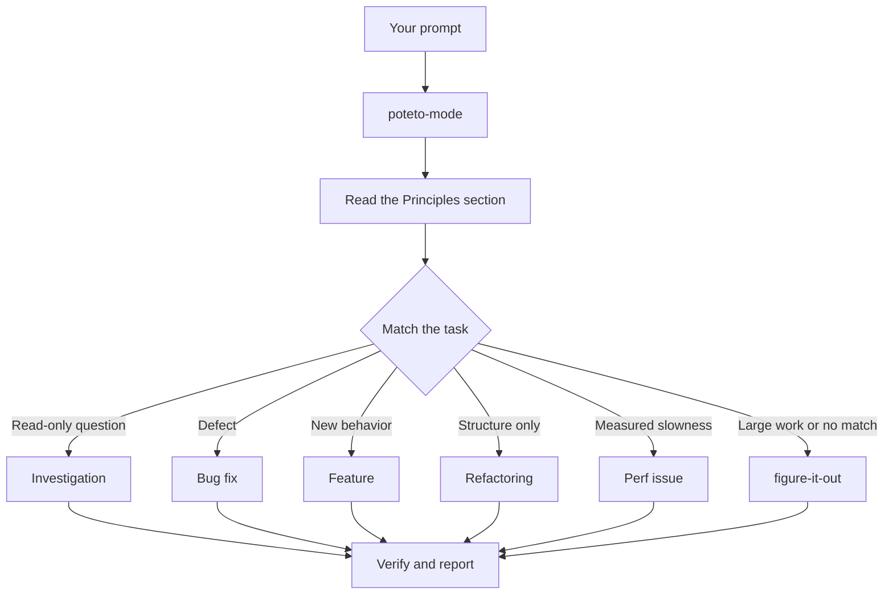

# 通过 `/poteto-mode` 分派工作

`/poteto-mode` 是前门。你给它一个目标，它从二十三本行动手册中匹配一本，把那本手册的步骤复制进待办列表，并按步骤的需要调用其他技能。在本页中，你会学到好的提示词长什么样，以及你实际上需要写多小的篇幅。


## 你的提示词会经历什么



图中展示了常见路由。此外还有用于这些场景的行动手册：爬坡优化某个指标、诊断运行时症状与抓取的追踪、原型、视觉一致性、编写与评估技能、自主运行、照看 PR 或 PR 栈直到可合并、交付已验证的 PR 栈、自动驾驶式处理 PR 队列、编排项目级计划、会话接续、安全暂停、多阶段计划，以及 worktree 清理。完整列表见[行动手册目录](../../skills/poteto-mode/playbooks/)。

## 说目标，不说仪式

你不需要写规格说明。你说出哪里不对或你想要什么，再加上任何你已经知道、能帮代理省时间的信息：

```text
/poteto-mode users get two notifications after a retry. repro first, then fix and verify.
```

这是一条 Bug fix 提示词。"repro first" 是真正的约束，不是客气话，行动手册会遵守它。看着待办列表被 Bug fix 步骤填满。被跳过的步骤会带着 `skip: <reason>` 保持可见。

## 提示词里放什么

一条有用的提示词最多承载五样东西，每样一句话就能说完：

- **目标。** 说出哪里不对，或你想要什么。
- **完成检查。** 它必须能通过或失败。"让它更好"和"做一个小时"都不是检查。
- **你想看到的证据。** 要求真实的命令输出、流程视频、存储的值，或前后对比的数字。
- **你已经知道的。** 一个症状、一步复现、一行日志或一个链接，都能省掉代理一次搜索。
- **真正的约束。** "repro first"、"先别改任何代码"、"零行为变化"、"继续之前让我过目"，每一条都会改变代理的行为。

下面是一条五样俱全的提示词：

```text
/poteto-mode the csv export drops its last row since yesterday's deploy. failing job id is 4812. repro first, then fix. done means the 60k-row fixture exports every row. show me the row counts before and after.
```

有两样东西值得省掉：

- **怎么做。** 说出要达成什么，给代理留出空间去找一条比你选的更好的路径。列技能清单也一样，见下面的陷阱。
- **一开始就说出你对原因的推测。** 说出口的猜测会把搜索范围收窄到你指的方向。先让代理重述问题，再分享你的直觉。

对于嘈杂的报告，比如长讨论串或含糊的 bug，把重述作为第一步：

```text
/poteto-mode read this thread. restate the underlying issue in your own words, in plain english. don't change any code yet.
```

误读会出现在重述里，在任何代码存在之前。在那里纠正它，你只花一条消息的代价，而不是一个错误修复的代价。

## 简短跟进

当对话已经带着上下文时，提示词几乎可以缩到没有。这些全都够了：

```text
/poteto-mode do it
```

```text
continue
```

```text
keep going until done
```

简短之所以可行，是因为行动手册承载了结构，而 Custom Mode 让 `/poteto-mode` 每一轮都在上下文中。[安装 pstack](./01-setup.md#run-your-first-task) 展示了如何开启一个。你的话承载意图，技能承载严谨。

## 用 "new task" 切换任务

长聊天会累积上一个任务的上下文。换主题时，要说出来：

```text
/poteto-mode new task. figure out why the cache entry survives logout. don't change any code yet.
```

"new task" 告诉 `/poteto-mode` 重新匹配，而不是继续之前的行动手册。"don't change any code yet" 把这个任务钉在 Investigation 上。没有这两个短语，处于 Feature 中途的模式倾向于把你的问题当作下一个功能步骤。

## 给并行工作各配一台机器

如果你在一台电脑上对一个仓库跑多个代理，它们会争抢工作树、端口和构建产物。最干净的隔离是 [cloud subagent](https://cursor.com/docs/subagents#cloud-subagents)（云端子代理）。每个云端子代理都有自己的 VM 和分支，所以它可以安装依赖、运行你的应用并录制结果视频，完全不碰你的机器。在任务前输入 `/in-cloud`，或让父聊天把工作交给云端子代理。

当工作必须留在本地时，一开始就要求一个 worktree：

```text
/poteto-mode new task. branch off <base> in a fresh worktree, then port the parser change there.
```

每个任务都在自己的分支和 worktree 里，就没有代理会踩坏另一个的文件。Worktree 消耗磁盘和机器资源，所以一台笔记本同时只能跑几个。[Opening a PR 行动手册](../../skills/poteto-mode/playbooks/opening-a-pr.md) 对代码变更本来就基于 worktree 工作，所以大多数时候，只有当特定基线或位置重要时你才需要这么说。

Worktree 会越积越多。磁盘紧张时，问一句：

```text
/poteto-mode what's eating my disk? prune the worktrees that are safe to prune.
```

[Worktree cleanup 行动手册](../../skills/poteto-mode/playbooks/worktree-cleanup.md) 会按合并状态、未提交工作和哪些聊天仍在使用，对每个 worktree 分类。它只删除证据表明可以安全删除的；对持有未提交工作的，会停下来等你决定。

## 让它自己跑

你要离开时，说清楚什么叫完成，然后走人：

```text
/poteto-mode im stepping away. keep going until the migration check reports zero old callers. log your decisions.
```

你稍后要评审的工作会经由 [`/figure-it-out`](../../skills/figure-it-out/SKILL.md) 路由，它会设计这次运行的各个阶段，并维护一份 [`/show-me-your-work`](../../skills/show-me-your-work/SKILL.md) 决策日志。[睡觉时也在跑的工作](./07-overnight.md) 涵盖完整的过夜契约。

**陷阱：** 不要在提示词里罗列技能（"use /how, then /architect, then /arena..."）。行动手册已经排好了它们的顺序，手写的顺序通常会重排或丢掉行动手册本来会保留的步骤。只有当你想覆盖某个具体选择时才点名技能。

阅读 [`poteto-mode`](../../skills/poteto-mode/SKILL.md) 本身以了解完整的路由规则。

下一篇：[理解代码](./03-understand.md)。
