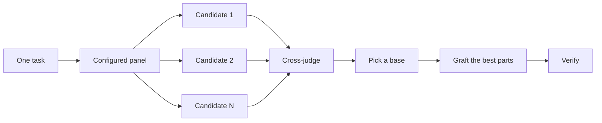

# 先设计，再写代码

面对一个艰难的设计，只做一次尝试就会把模型想到的第一个形状锁死。`/architect` 在动手实现之前先把类型和边界定下来。`/arena` 针对同一份需求简报跑出多个方案，再把各自最好的部分合并起来。`/interrogate` 让其他模型来试着打垮这个结果。当任务是覆盖性检查而非设计综合时，`/swarm` 会铺开多个切片或竞速分支，并汇总它们的结果。

最常见的两个设计错误是：直接采用代理给出的第一个设计，以及打磨一份从未被任何代码验证过的计划。本页会同时解决这两个问题。你要通过代码来做计划：用原型回答悬而未决的问题，用一份 README 或教程设定目标，书面计划放到最后写。


## 用 `/architect` 定形状

```text
/architect design the import pipeline before writing any code. i care most about how callers use it.
```

[`/architect`](../../skills/architect/SKILL.md) 会先让自己摸清现状：对设计涉及的代码运行 `/how`，当设计要挪动归属或分层时运行 `/why`。然后它会运行 `/arena` 产出互相竞争的设计草图，每一份都先写调用方的用法，再写类型、签名和模块图。

默认情况下，它会从综合出的设计直接进入实现。如果你想先看到设计，就说出来：

```text
/architect with checkpoint. stop and show me before implementing.
```

代码开工之后，设计也不是神圣不可侵犯的。如果实现过程中，互不相干的地方出现同样的变通手法，或者类型只能靠 `any` 或强制转换才能编译通过，`/architect` 会把这当作设计有误的证据。它会扔掉草图从头再来，而不是围着问题打补丁。

## 用 `/arena` 铺开多个尝试

```text
/arena take my prompt to the arena verbatim. i want to compare their proposals with yours.
```

[`/arena`](../../skills/arena/SKILL.md) 是底层那个通用工具。N 个子代理并行尝试同一份设计或编码简报，各自写入自己的 worktree 或目录。一个只读评委——在你的配置允许时来自不同的模型家族——按照评分细则给每个候选方案打分。协调者把每个候选从头到尾读完，挑出一个基底，把败者最好的想法嫁接进去，然后验证结果。



评审团来自你的 [`/setup-pstack`](../../skills/setup-pstack/SKILL.md) 配置，你也可以按任务调整。决策重要就多要几个候选，不重要就少要：

```text
/arena this, 5 candidates. the cache key format is expensive to change later.
```

## 用 `/swarm` 覆盖切片和竞速

```text
/swarm check every package under packages/ against its check.sh. one worker per package. one report.
```

[`/swarm`](../../skills/swarm/SKILL.md) 把 N 个工人铺到彼此独立的切片、覆盖矩阵、闯关通道、探索分区或声明好的竞速分支上。每个工人有自己的范围和检查项，然后汇报 `PASS`、`ISSUES` 或 `BLOCKED`。父代理等工人们跑完，返回一份紧凑的报告，附上任何缺口或掉队的工人。

当并行能换来覆盖度，或者能让彼此独立的检查互相竞速时，就用它。`/arena` 给每个工人同一份设计或编码简报，然后选一个基底、嫁接最好的部分。`/swarm` 则是覆盖切片，或者跑一场事先声明好选择规则的竞速。它不搞选基底和嫁接那套仪式。

## 用 `/interrogate` 打垮它

```text
/interrogate the whole branch, but skeptically. no nitpicks unless it's an actual bug or regression.
```

[`/interrogate`](../../skills/interrogate/SKILL.md) 把同一份 diff、意图和评分细则发给不同模型家族上的评审。模型多样性正是意义所在。不同模型有不同的盲区，所以两个模型各自独立提出的发现是高置信度信号。主评审把所有发现归入 `Act on`、`Consider`、`Noted` 和 `Dismissed` 四档，每条驳回都给出理由，并且不会自动应用任何修改。

被驳回的也要读。主评审是个务实的高级工程师，不是神谕，你可以推翻它的判断。

## 用原型代替争论

永远不要接受第一个设计。多要几个，然后基于你看得见的证据来挑：

```text
/poteto-mode prototype a few options for the new dropdown menu. take screenshots or videos for me to compare.
```

[原型行动手册](../../skills/poteto-mode/playbooks/prototype.md)会在临时目录里搭一些用完即弃的草样，把所有变体放到一个切换器后面，逐个驱动，并截取屏幕截图或计时数据。它不只适用于 UI，对行为和算法同样有效。原型就是用代码做计划。它让代理靠运行点什么来回答自己悬而未决的问题，而不是反过来问你，还给你可能根本想不到的选项留出了空间。

同一个思路可以放大到真正的设计上。把 `/architect` 和原型搭配起来，并保留一道评审关卡：

```text
/poteto-mode we need rate limiting for external webhooks. /architect it first, and answer open questions with prototypes. let me review before proceeding.
```

别把评审浪费在一份抽象的计划上。`/interrogate` 属于 diff。让对抗性评审对着一份背后没有代码的计划，评审们只会凭空发明永远不会发生的理论风险和边界情况。让原型把问题敲定，然后评审真正构建出来的东西。

## 共享代码先写 README

对于一个包或一套会被其他代码使用的 API，从用户会读到的那份文档开始：

```text
/poteto-mode write a tutorial for how i would use the new config package first. then /teach me why it beats the current one.
```

先写教程会迫使你站在调用方的视角。你向一个假想用户描述这套 API，再倒推出实现。这份文档也会成为代理自检工作的具体靶子。当文档本身很重要时，点名 [`/technical-writing`](../../skills/technical-writing/SKILL.md)，这样教程就始终是教程，而不是同时漂移到参考手册和解释文里去。

## 设计敲定之后再写计划

pstack 故意没有规划类技能。当你确实想要一份书面计划时，等设计敲定了再要：

```text
/poteto-mode turn this design into a plan. small verifiable PRs, each with its own verification steps.
```

[多阶段计划行动手册](../../skills/poteto-mode/playbooks/multi-phase-plan.md)会先用原型解决掉剩下的悬而未决的问题，然后为每个 PR 写一节，每节都以「证明改动有效」收尾。光靠测试套件全绿不算数。计划本身就是交付物。行动手册不会去实施它，还会点名接下来该由哪个执行类行动手册来跑。

对于迁移类工作，在提示词里把验收标准说清楚：

```text
/poteto-mode plan the migration of our ui library to the new styling system. small verifiable PRs, each with visual regression checks. the result must match the original exactly, bugs included.
```

「bugs included」（连 bug 也要一致）能防止迁移顺手悄悄修东西，否则新旧输出就没法比对了。对于横跨多天的项目，你可以把计划提交到仓库里放一阵子，让其他代理也能看到进行中的工作。工作落地后再把它删掉。

## 一个任务值得多少设计工作？

你可能会想，是不是每个改动都需要这套流程。不是。大多数改动一样都不需要。一把粗略的梯子：

- 一个你心里没底的、已完成的小改动，只需要 `/interrogate`。
- 一个跨越函数边界或挪动归属的改动，够格用 `/architect`，而它会顺带带上 `/arena`。
- 一个独立决策，如果多种独立尝试会有帮助——比如命名、格式或某个算法——直接用 `/arena`。
- 一个覆盖矩阵、一组并行检查，或一场声明了分支的竞速，用 `/swarm`。
- 一个跑点什么就能回答的开放问题——比如某种布局、一项耗时、一条路线——去做原型，而不是开辩论会。
- 一个存在争议且反转代价高昂的设计，用 `/architect`，发布前再上 `/interrogate`。
- 横跨多个 PR 的工作，写一份计划，在设计敲定之后写。

`/poteto-mode` 已经在应用这把梯子了。跨边界的工作会自己触发 `/architect`，所以你主要在想比默认更严或更松时，才直接点名这些技能。

下一篇：[构建改动并清理 diff](./05-build-and-clean.md)。
