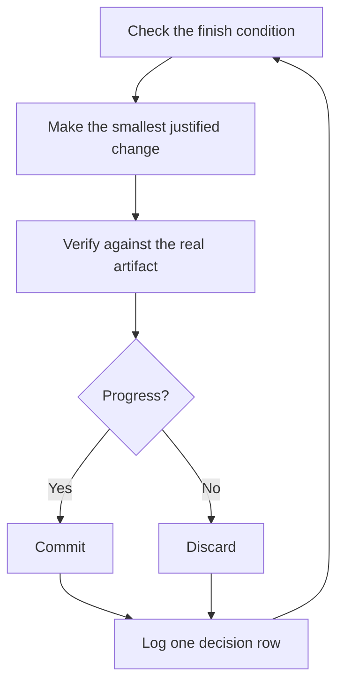

# 睡觉时让工作继续跑

这是之前一切的回报。一个你信得过、能验证自己工作的代理，就是一个你敢于留它独自面对艰难任务的代理。让这成为可能的不是运气，而是：可检查的完成条件、隔离的 worktree 或云端代理，以及一份你早上审计的决策日志。


## 先赢得信任，再上循环

一个你不信任的循环只会更快地产出没人检查的工作，而且混乱会随每次迭代复利增长。在你留下一个循环自己跑之前，检查它是否已经挣得了这份信任：

- 这个任务你亲手做过一次，或者看着代理做过，所以你知道「好」长什么样。
- 代理拥有你自己会用的工具和信号：验证技能、剖析器、日志。
- 每个阶段都会证明自己的产出，并且在不达标时能让流水线停下。
- 你读过几份会话记录，并把反复出现的失败变成了工具、技能或检查。

四条都成立，再让循环自主运行。在那之前，开着它、盯着它。

## 过夜契约

一次好的交接包含目标、完成条件、权限和一个逃生舱口。不需要很长：

```text
/poteto-mode im going to bed. migrate every caller to the new parser in a fresh worktree off <base>.
done means zero old callers, all parser fixtures pass, old api deleted.
keep a decision log. don't ask me before committing.
/loop until done. if you're truly stuck after a few hours, stop and write up why.
```

逐行看看每一句给你换来了什么：

- 「im going to bed」是会话级覆盖。代理停止提问，继续干活。
- 「done means...」把目标变成每次迭代都能运行的检查。
- 「fresh worktree off `<base>`」让这次运行不会和你开着的任何其他东西相撞。
- 「don't ask me before committing」提前回答了代理否则会卡住的权限问题。
- `/loop` 是 Cursor 内置的唤醒机制，不是 pstack 技能。[自主运行行动手册](../../skills/poteto-mode/playbooks/autonomous-run.md)用它按事件或心跳重新检查完成条件。
- 逃生舱口允许它在真正走进死胡同时停下来并写清原因，这好过八个小时对目标的创造性曲解。

因为你将在离开之后评审这些工作，`/poteto-mode` 会把它路由到 [`/figure-it-out`](../../skills/figure-it-out/SKILL.md)，后者会在任何代码动工之前设计好这次运行的各个阶段，并接入决策日志。

要有意停掉一次运行，告诉代理暂停，或者告诉它你即将离线或重启 Cursor。[安全暂停行动手册](../../skills/poteto-mode/playbooks/pause-safely.md)会完成或回退当前步骤，提交一个进行中检查点，并写下恢复说明。新的聊天会通过「会话接续行动手册」从这份说明接手工作。说「keep going」永远不会触发暂停。

## 循环整夜在做什么



每次迭代：一个改动、一次检查、一行日志。没帮上忙的改动被丢弃，而不是留着搭车。平台期意味着转向，不是停下，完成条件也永远不会悄悄放宽来宣布胜利。

## 晨间审计

[`/show-me-your-work`](../../skills/show-me-your-work/SKILL.md) 是让这次运行可评审的东西。每一行记录时间、阶段、决定、理由、证据指针和结果，存在 `decisions.tsv` 这个 TSV 文件里（当多个运行共用一个目录时是 `.audit/<task-slug>.tsv`）。它默认留在本地。当工作重要到评审者需要这条轨迹才能信任结果时，就把它提交进仓库。

你回来之后，让运行以评审的形式汇报：

```text
/show-me-your-work catch me up on what you did last night
```

技能交回摘要之前，会生成一个来自不同模型家族的评审去读轨迹和会话记录，回复末尾是一个 Attention（注意）小节，列出值得你审视的地方。先读那一节，再读它指向的日志行。你是在审计决策，不是把整晚重读一遍。

## 当夜里装的是队列而不是单个任务

上面的契约把单个任务推进到单个完成条件。有些夜晚装的更多：一串彼此独立的改动，或一整个项目。三个行动手册把同一份信任放大。

[Autopilot-full](../../skills/poteto-mode/playbooks/autopilot-full.md) 把一队独立的 PR 推进到合并。每个 PR 有一个负责代理，从构建一路带到合并，但没有任何负责代理凭自己的判断合并。一群全新的验证者在负责代理宣布代码就绪的节点启动一轮，之后每次改动补丁的推送再启动一轮。只有对最终要合并的那个补丁拿到干净判定，才授权合并：

```text
/poteto-mode full autopilot on this queue. each item is independent. i want them merged by morning.
```

[Autopilot-stack](../../skills/poteto-mode/playbooks/autopilot-stack.md) 跑同样的负责代理循环，但什么都不交付。你醒来时面对的是一个线性的基底分支堆叠，每一环都有验证者的判定，由你自己评审并落地。当改动相互耦合，或者你想在任何东西合并之前亲眼过一遍时，选它而不是 Autopilot-full：

```text
/poteto-mode autopilot these five changes but stack them, don't ship. i'll land the stack in the morning.
```

[Orchestrate](../../skills/poteto-mode/playbooks/orchestrate.md) 面向活得比任何单个代理都久的项目：跨越多天、许多叠放的 PR、一个常设协调聊天之下的一队子代理。协调者撰写简报、收集子代理完成的东西、保持最底层未合并的 PR 常绿，并且自己从不写代码。它是刻意造出来的重型机械。如果一个代理一个会话就能完成这项工作，这个行动手册自己会把你指回上面的过夜契约：

```text
/poteto-mode orchestrate the store migration. own it until every package is converted and merged. i'll check in twice a day.
```

## 并行跑多个项目

一个 [Cursor Project](https://cursor.com/blog/projects) 给一个协调代理一条持久的线程。协调者不写代码，它指挥子代理，子代理默认在云端运行，所以你合上笔记本工作也继续。这正是 Orchestrate 行动手册期望的形状。给协调者的提示词以 `/poteto-mode` 开头，它生成的子代理就会遵循这些行动手册。

几个有用的习惯：

- 给每块工作自己的 Project，比如一个功能、一次迁移、一轮性能攻坚或一次技术债清理。几个可以并排跑。
- 把相关的聊天拖进 Project，包括已结束的。它们会成为其中每个代理的上下文。
- 每个 PR 合并前都给它一群验证者，让 Autopilot-stack 或 Autopilot-full 来扛队列。
- 向协调者要一份有数据支撑的计划，让它在来问你之前先用原型回答开放问题。

一个提示词可以承载一整个 Project，从调研到执行：

```text
/poteto-mode refactor this repo so its architecture is more agent friendly. use /correct and /architect on past commits and review comments to find the mistakes agents make most here. use /recall for context from past chats. answer open questions with prototypes instead of asking me. come back with a plan backed by real data. once i approve it, run it with autopilot-stack or autopilot-full, and ask me which.
```

## 让循环自己启动

上面每个循环仍然等你去启动它。定时或事件驱动的自动化把这一步也省了。软件维护天然分成几个适合这么做的阶段：分诊一条报告、复现它、修它、验证修复。两条规则让这样的流水线保持可信：

- 每个阶段都能让流水线停下。分诊可以判定报告是预期行为，复现可以复现失败，修的人可以判断改动风险太大。这些结果每一个都有用，因为它们把坏工作挡在下一个阶段之外，在那里撤销的代价更高。
- 每个阶段都交出证据。复现附上坏掉状态的截图和视频，修复附上前后对比的证明。这样人类在读一行代码之前，就能先确认代理修对了东西。

pstack 以一套休眠的[自动化包](../../automations/benny/README.md)的形式附带了这个能力，面向 Slack 问题报告。一个自动化分诊每条报告，另一个复现确认的 bug，并可能准备一个小型修复草稿。让一个代理去读它的 [`FOR_AGENTS.md`](../../automations/benny/FOR_AGENTS.md) 并指明目标仓库，即可完成配置。

**陷阱：**时长不是完成条件。「work on this for 4 hours」没给代理任何可检查的东西，你醒来得到的会是四个小时的动作，而不是一个结果。给 `/loop` 一个能判定通过或不通过的谓词。

下一篇：[用原则名来掌舵](./08-principles.md)。
